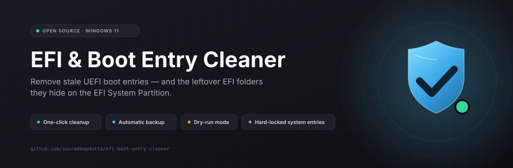
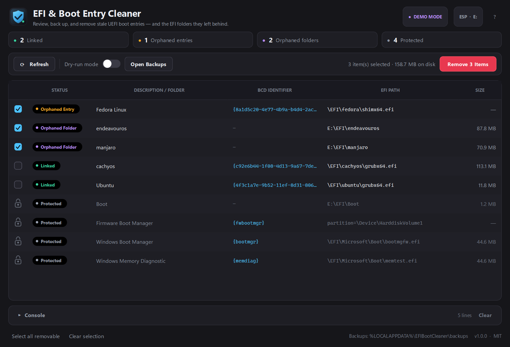
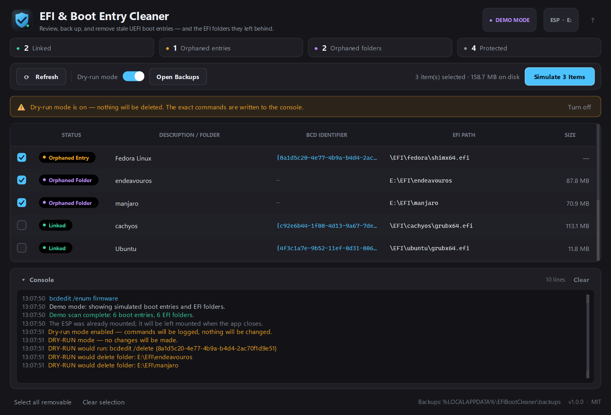
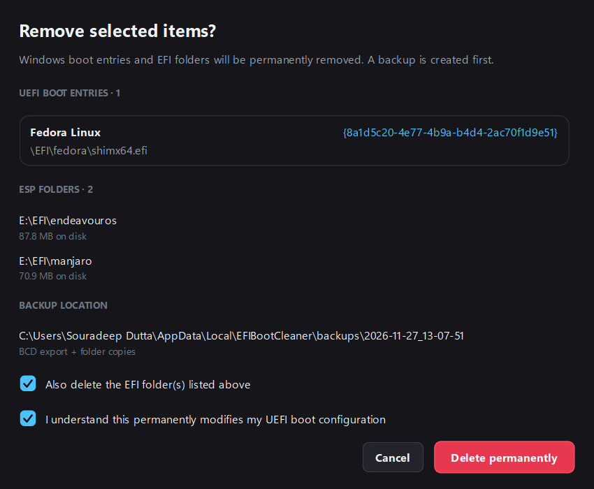
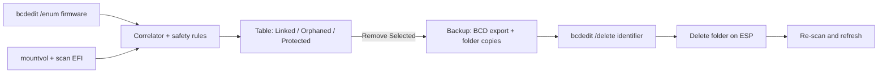

<div align="center">
  
</div>

<p align="center">
  <a href="https://github.com/souradeepdutta/efi-boot-entry-cleaner/releases/latest"></a>
  <a href="https://github.com/souradeepdutta/efi-boot-entry-cleaner/actions/workflows/tests.yml"></a>
  <a href="https://github.com/souradeepdutta/efi-boot-entry-cleaner/blob/main/LICENSE"></a>
  <a href="https://github.com/souradeepdutta/efi-boot-entry-cleaner/stargazers"></a>
</p>

<p align="center">
  
  
  
  
</p>

<h3 align="center">Old Linux installs leave two things behind: a UEFI boot entry and a folder on the hidden EFI System Partition.</h3>

<p align="center">
  This app shows both in one table, tells you which ones are stale, backs them up, and removes them in one click.
</p>

<p align="center">
  <a href="https://github.com/souradeepdutta/efi-boot-entry-cleaner/releases/latest"><b>⬇ Download for Windows 11</b></a>
  &nbsp;·&nbsp;
  <a href="#safety-model">Safety model</a>
  &nbsp;·&nbsp;
  <a href="#build-from-source">Build from source</a>
  &nbsp;·&nbsp;
  <a href="#faq">FAQ</a>
</p>

<p align="center">
  
</p>

---

## Why this exists

When you delete a Linux partition, format a drive, or abandon a dual-boot setup,
Windows happily keeps the firmware boot entry. `bcdedit /enum firmware` still
lists **ubuntu**, **Fedora**, or **cachyos**, the UEFI boot menu still offers
them, and the `.efi` files still sit in a folder on the EFI System Partition
(ESP) — a hidden FAT32 partition that normally has no drive letter.

Cleaning that up by hand means:

1. finding a free drive letter and running `mountvol X: /S`,
2. parsing `bcdedit` output and matching GUIDs to `\EFI\<folder>\*.efi` paths,
3. exporting the BCD store and copying the folder *before* deleting anything,
4. deleting the entry with `bcdedit /delete {guid}`,
5. deleting the folder with the right permissions, then unmounting the ESP.

**EFI & Boot Entry Cleaner does all five steps from a checkbox table — with the
destructive parts hard-locked behind safety rules, a dry-run mode, and an
automatic timestamped backup.**

---

## What it does

| | |
|---|---|
| **Scans** | `bcdedit /enum firmware` for every firmware boot entry (identifier, description, device, path). |
| **Mounts** | The EFI System Partition temporarily on the first free letter from `Z:` down to `M:`, and unmounts it on exit. |
| **Correlates** | Each `\EFI\<folder>\file.efi` path to its folder, with size and file count. |
| **Classifies** | Every item as 🟢 Linked, 🟡 Orphaned Entry, 🟣 Orphaned Folder, or ⚪ Protected. |
| **Backs up** | BCD export + firmware snapshot + copies of the folders, before anything is deleted. |
| **Removes** | The selected `bcdedit` entries and their ESP folders, then re-scans automatically. |
| **Logs** | Every command, exit code, stdout/stderr line and backup path in a live console. |

### Status meanings

| Status | Meaning | Selectable |
| --- | --- | --- |
| 🟢 **Linked** | A boot entry exists **and** its `.efi` file and folder are present. | Yes |
| 🟡 **Orphaned Entry** | A boot entry exists, but the `.efi` file or folder is gone. | Yes |
| 🟣 **Orphaned Folder** | A folder exists in `\EFI\`, but no boot entry points to it. | Yes |
| ⚪ **Protected** | Windows boot manager, well-known identifiers, `\EFI\Microsoft`, `\EFI\Boot`. | **No** |

---

## Screenshots

<p align="center">
  
  
</p>

<p align="center">
  <sub><b>Left:</b> dry-run mode logs the exact commands without touching the system. &nbsp; <b>Right:</b> the real deletion lists every identifier, path and the backup destination first.</sub>
</p>

---

## Download and run

### The easy way

1. Open the [latest release](https://github.com/souradeepdutta/efi-boot-entry-cleaner/releases/latest).
2. Download `EFI-Boot-Entry-Cleaner.exe` (optionally verify `SHA256.txt`).
3. Double-click it. Windows shows a UAC prompt — the app needs Administrator
   rights to read the BCD store and mount the ESP.

> **SmartScreen:** the executable is not code-signed, so Windows may say
> *"Windows protected your PC"*. Choose **More info → Run anyway**. The source
> is here and every release is built by the public GitHub Actions workflow in
> this repository.

**Requirements:** Windows 11 (x64), UEFI firmware, Administrator rights.
Windows 10 with UEFI will most likely work but is not the primary target.

### The source way

```powershell
git clone https://github.com/souradeepdutta/efi-boot-entry-cleaner.git
cd efi-boot-entry-cleaner

py -3.12 -m venv .venv
.\.venv\Scripts\Activate.ps1
pip install -r requirements.txt

python main.py          # relaunches itself elevated via UAC
python main.py --demo   # simulated data, no admin, nothing is touched
```

`--demo` is the fastest way to see the UI or work on it: it never mounts,
reads or deletes anything.

---

## Using it

1. **Launch** — the app mounts the ESP and scans both sources automatically.
2. **Read the table.** Orphaned entries and folders are the usual cleanup
   candidates. Protected rows show a lock and cannot be checked.
3. **Check one or more rows.** The red button shows how many items and how much
   disk space are selected.
4. *(Optional)* Turn on **Dry-run mode** and click the button to log exactly
   what would happen.
5. **Remove Selected** — confirm the identifiers, folder paths and backup
   location; optionally untick *"Also delete the EFI folder(s)"* to keep the
   files.
6. The app backs up first, then deletes the BCD entry and the ESP folder, then
   re-scans.

If a folder is still referenced by an **unselected** boot entry, it is kept and
reported in the console — even if you checked it.

### Keyboard shortcuts

| Key | Action |
| --- | --- |
| `F5` | Refresh / re-scan |
| `Delete` | Remove selected |
| `Ctrl+L` | Toggle the console |
| `Ctrl+Q` | Quit (unmounts the ESP) |

---

## Safety model

This tool edits boot configuration, so the guardrails are the feature.

### Hard-locked, always

| Item | Why it is untouchable |
| --- | --- |
| `{bootmgr}` and the active Windows Boot Manager | Deleting it can make Windows unbootable. |
| `{fwbootmgr}` | The firmware boot manager itself, not an OS entry. |
| `{current}`, `{default}`, `{memdiag}` | Referenced by the running Windows installation. |
| `\EFI\Microsoft` | Windows boot files (`bootmgfw.efi`, BCD, fonts, …). |
| `\EFI\Boot` | The fallback/removable-media boot path used by many distros. |

Protected items have no checkbox, are greyed out, and are filtered out again
inside the controller and in `bcdedit` deletion itself. Tests assert that every
protected identifier can never become deletable.

### Backups before deletion

Every real removal creates:

```
%LOCALAPPDATA%\EFIBootCleaner\backups\<YYYY-MM-DD_HH-MM-SS>\
├─ bcd_backup              ← bcdedit /export
├─ firmware_entries.txt    ← bcdedit /enum firmware snapshot
└─ efi_files\
   └─ ubuntu\              ← full copy of the folder(s) being deleted
```

If the backup fails, **nothing is deleted**. The backup folder is never removed
by the app.

### Other protections

- **Dry-run is the default switch away** — commands are logged, nothing is
  written, not even a backup.
- **Confirmation is mandatory** and requires an explicit *"I understand…"*
  checkbox before the destructive button enables.
- **Deletion is limited to direct children of `<ESP>:\EFI`.** Path traversal,
  nested paths and anything outside the mount are rejected.
- **Read-only files** are handled safely during folder copies and removal.
- **The ESP is unmounted on every exit path**: `try/finally`, `atexit`, and Qt's
  `aboutToQuit`. An already-mounted ESP is reused and left alone.
- **Shared folders are kept** if another boot entry still points at them.
- **No network access, no telemetry, no accounts.**

### Restoring a backup

The BCD export restores the Windows boot store:

```powershell
bcdedit /import "<backup>\bcd_backup"
```

Folder contents can be copied back after mounting the ESP:

```powershell
mountvol Z: /S
xcopy "<backup>\efi_files\ubuntu" "Z:\EFI\ubuntu\" /E /I
mountvol Z: /D
```

`bcdedit /export` covers the Windows BCD store. Firmware entries deleted from
the firmware store are documented in `firmware_entries.txt`; recreate one from
Linux with `efibootmgr` (or from Windows with `bcdedit /copy` + `/set`) if you
ever need it back. **Windows Boot Manager is never touched, so Windows itself
stays bootable.**

---

## How it works



- `core/bcd_parser.py` runs `bcdedit`, parses blocks with multi-line values, and
  exposes safe delete/export helpers.
- `core/esp_manager.py` finds a free letter, mounts the ESP, computes folder
  sizes, copies folders and performs guarded `rmtree` calls.
- `core/correlator.py` merges both data sources and is the single place that
  assigns a status and decides deletability.
- `core/controller.py` sequences scan → backup → delete → report.
- `ui/` contains the PySide6 window, painted widgets, dialogs and the demo data.

The core modules never import Qt, which is why the tests run in CI without a
desktop or elevation.

---

## Build from source

```powershell
.\build.ps1
```

The script:

1. checks Python 3.11+,
2. installs `PySide6` and `PyInstaller`,
3. regenerates `assets/app.ico` from `tools/make_icon.py`,
4. builds **one file**, windowed, with a `requireAdministrator` manifest
   (`--uac-admin`),
5. prints the size and SHA-256 of the artifact.

Output: `dist\EFI-Boot-Entry-Cleaner.exe`.

Use `.\build.ps1 -OneDir` for a folder build (faster startup, many files).
Tagging `v*` triggers the release workflow, which builds the same executable on
`windows-latest` and attaches it to a GitHub Release.

---

## Tests

```powershell
pip install -r requirements-dev.txt
python -m pytest -q
python -m ruff check .
```

The suite mocks `bcdedit` output (Windows Boot Manager, Ubuntu GRUB, Fedora shim,
cachyos) and the file system. It covers:

- multi-line parsing, CRLF/tab/whitespace variants and error output,
- every protected identifier, the active Windows Boot Manager and Windows
  folders — asserted **never deletable**,
- linked/orphaned classification, case-insensitive path matching and sorting,
- ESP deletion guards (outside path, nested path, protected folder, dry-run),
- backup-before-delete ordering, aborted backups, shared-folder retention.

---

## Project structure

```
.
├─ main.py                     # entry point, UAC relaunch, crash log
├─ core/
│  ├─ bcd_parser.py            # bcdedit run/parse/delete/export
│  ├─ esp_manager.py           # mount, scan, copy, guarded delete
│  ├─ correlator.py            # status classification
│  ├─ safety.py                # hard-locked identifiers and folders
│  ├─ controller.py            # scan → backup → remove pipeline
│  ├─ efi_paths.py             # path normalisation helpers
│  ├─ privileges.py            # IsUserAnAdmin + ShellExecuteW runas
│  ├─ resources.py             # source/PyInstaller asset paths
│  └─ version.py
├─ ui/
│  ├─ main_window.py           # table, toolbar, worker thread
│  ├─ widgets.py               # switch, badges, lock checkbox, console
│  ├─ dialogs.py               # confirmation + about
│  ├─ theme.py                 # dark Windows 11 palette and QSS
│  └─ demo.py                  # simulated data for --demo/screenshots
├─ tests/                      # pytest suite (no admin needed)
├─ tools/                      # icon and screenshot generators
├─ packaging/                  # Windows version resource
├─ assets/                     # banner, screenshots, icon
├─ build.ps1
└─ requirements.txt
```

---

## FAQ

**Is this safe?**
It is designed to be boring and reversible: everything is backed up first,
system entries are hard-locked, dry-run shows the commands, and the final dialog
lists exactly what will go. That said, this program edits boot configuration
data — read the confirmation, and keep the backup until you are sure.

**Does it work with Secure Boot?**
Yes. It removes boot entries and EFI binaries only; it does not touch Secure
Boot keys, the KEK/db, or BitLocker.

**Can it delete my Windows boot entry?**
No. `{bootmgr}`, `{fwbootmgr}`, `{current}`, `{default}`, `{memdiag}`,
`\EFI\Microsoft` and `\EFI\Boot` are disabled in the table, filtered again in the
controller, and rejected a third time before `bcdedit /delete`.

**Why does it need Administrator rights?**
`bcdedit` writes to the boot configuration store and `mountvol` mounts a system
partition. Both require elevation. The app checks `IsUserAnAdmin()` and
relaunches itself through UAC if needed.

**The ESP already had a drive letter. What happens?**
The app detects it, uses it, and does **not** unmount it when it closes.

**Can I keep the EFI files and only remove the boot entry?**
Yes — untick *"Also delete the EFI folder(s)"* in the confirmation dialog.

**Does it phone home?**
No. There is no networking code, no telemetry, no update check. The only files it
writes are backups and crash logs under `%LOCALAPPDATA%\EFIBootCleaner`.

**Why "Orphaned Entry" for an entry whose folder exists but file is missing?**
The entry points at a file that is not on the ESP, so booting it would fail. The
row is safe to remove, and the stale folder (if any) is shown with it.

**Windows 10?**
The commands and layout are the same. Windows 11 is the tested target.

---

## Contributing

Issues and pull requests are welcome. Start with
[CONTRIBUTING.md](CONTRIBUTING.md) — it explains how to run the UI in demo mode,
the test suite, and the safety rules that changes must preserve.

For anything that could delete data or bypass a guardrail, please use
[private vulnerability reporting](https://github.com/souradeepdutta/efi-boot-entry-cleaner/security/advisories/new)
instead of a public issue. See [SECURITY.md](SECURITY.md).

If this saved you an afternoon of `mountvol` and GUID hunting, a ⭐ helps other
people find it.

---

## License and disclaimer

MIT — see [LICENSE](LICENSE).

This project is not affiliated with Microsoft. Modifying boot configuration can
make a machine unbootable if used carelessly. The software is provided **as is**,
without warranty; you are responsible for the changes you confirm. Always keep
the generated backup until the machine has rebooted successfully.
